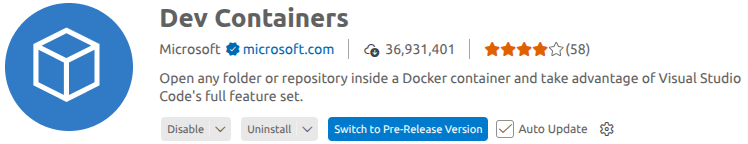

[](INSTALL.md) [](INSTALL.es.md)

# Setting Up the Working Environment

Integrated circuit design tools are, in general, originally built for UNIX-based operating systems (such as Linux). For this reason, the working environment for this workshop uses the Ubuntu 22.04 Linux distribution. If this is your first time using Linux, don't worry! We will only do a few basic things, like copying files with `cp` or moving to specific paths with `cd`. You can also check the [Linux Cheatsheet](./digital_basics.pdf) at the end of the workshop slides to review basic commands.

## Git/GitHub

As you can see, you are currently in a GitHub repository, but what exactly are Git and GitHub?

### What is Git?

**Git** is a free version control system that lets you keep track of changes to your files. Imagine you are writing code and add a new feature that unfortunately introduces errors, so the program no longer works. Without Git, to go back to the version that worked, you would have to remember every change you made and undo them one by one.

With Git, you can take a "snapshot" of your code before making changes, so you can always return to that point. In Git, that snapshot is called a **commit**. It's like having a super-powered "undo" button that lets you go back to any earlier point in your project.

### What is GitHub?

**GitHub** is a cloud platform that works as a "home" for your projects that use Git. Think of GitHub as a Google Drive specialized for code projects. The advantage is that many people can work on the same project without stepping on each other's toes: everyone makes their changes separately and then Git helps combine everything, resolving conflicts when two people change the same line of code in different ways.

### Installing Git

You are currently in a GitHub repository where all the files needed for the workshop are stored. To work with these files on your computer, you need to **clone** the repository (make a local copy). But first, you need to install Git.

1. **Install Git**: Go to [Git Install](https://git-scm.com/install/windows) and follow the instructions for your operating system (Windows, macOS, or Linux).

2. **Verify the installation**: Open a terminal (PowerShell on Windows, Terminal on macOS, or Bash on Linux) and run:
```bash
$ git --version
```
You should see something like `git version 2.x.x`, which confirms that Git is installed correctly.

3. **Clone the repository**: Once Git is installed, clone the repository with the command:
```bash
$ git clone https://github.com/ChipUBB/digital-basic.git
```

4. **Go into the repository**: Move into the repository directory with the command:
```bash
$ cd ./digital-basic
```

## Docker and DevContainers

Now that you have the workshop files on your computer, we need to set up the working environment. This is where Docker and DevContainers come in.

### What is Docker?

**Docker** is a tool for creating "containers". Picture them as portable boxes that include everything needed to run an application: the operating system, the tools, the libraries, and the configuration. It's like having a mini-computer inside your computer, but much lighter and more efficient.

**Why is it useful?** Without Docker, each person would have to manually install and correctly configure dozens of tools, which is complicated and error-prone. With Docker, everyone works in exactly the same environment, whether you use Windows, macOS, or Linux. If it works on your computer, it will work on everyone else's.

### What is a DevContainer?

A **DevContainer** (Development Container) is a special Docker configuration designed specifically for software development. Unlike a regular Docker container (which typically runs an application in server or batch mode with no direct interaction), a **DevContainer** is meant for you to work inside it as if it were your local development environment.

The key difference is that with a DevContainer you can use **Visual Studio Code** (VS Code) in a fully integrated way: you open VS Code on your normal operating system (Windows or Linux), but all the code runs, compiles and is tested inside the Linux container. VS Code connects to the container transparently, letting you edit files, use the terminal, install extensions, and debug code as if everything were on your local machine, while taking advantage of everything the container offers (preinstalled tools, the same environment for everyone, isolation, etc.).

In this workshop, the DevContainer comes with everything installed and ready to use: Digital, LibreLane, and the IHP PDK. This means **zero manual setup** on your side: just open the project in VS Code and you automatically get access to all these tools without "cluttering" your operating system with complex installations. And if you move your project to another computer, everything will keep working exactly the same, because the whole environment travels with the project.

### Installation and Setup

#### Step 1: Install Docker

Docker installation depends on your operating system:

**On Windows:**

1. Go to [Docker Desktop](https://docs.docker.com/desktop/setup/install/windows-install/) and download Docker Desktop for Windows.
2. Install Docker Desktop by following the installation wizard.
3. Once installed, open Docker Desktop and wait for it to fully start (you'll see a Docker icon in your taskbar).
4. Verify the installation by opening PowerShell and running:
```bash
$ docker --version
```
   You should see something like `Docker version 24.x.x`.

**On Linux:**

1. Follow Docker's official instructions for your distribution at [Docker Engine Install](https://docs.docker.com/engine/install/).
2. For Ubuntu/Debian, the basic commands are:
```bash
$ sudo apt-get update
$ sudo apt-get install docker-ce docker-ce-cli containerd.io
```
3. Add your user to the docker group so you don't need `sudo`:
```bash
$ sudo usermod -aG docker $USER
```
   Then log out and log back in for the changes to take effect.

4. Verify the installation by running:
```bash
$ docker --version
```
   You should see something like `Docker version 24.x.x`.

#### Step 2: Install VcXsrv (Windows only)

The integrated circuit design tools we will use (such as Digital and the LibreLane tools) have graphical interfaces that need an X11 server to work on Windows. **VcXsrv** provides this server, allowing the Linux graphical applications inside the container to be displayed on your Windows desktop.

**Installing VcXsrv:**

1. Go to [VcXsrv on SourceForge](https://sourceforge.net/projects/vcxsrv/) and download the installer.
2. Install VcXsrv by following the installation wizard with the default options.
3. Once installed, start **XLaunch** from the Start menu.
4. Configure XLaunch with the following options:
   - **Display settings**: Select "Multiple windows" and leave the display number at -1, then click "Next"
   - **Client startup**: Select "Start no client", then click "Next"
   - **Extra settings**: Check the "Disable access control" box, then click "Next"
   - Click "Finish"

5. **Important**: VcXsrv must be running every time you want to use the graphical tools. You'll see an XLaunch icon in your taskbar when it is active.

**Note for Linux users:** You don't need to install VcXsrv, since Linux has native X11 support.

#### Step 3: Install Visual Studio Code (VS Code)

**VS Code** is a modern, free code editor that integrates seamlessly with DevContainers.

1. Go to [Visual Studio Code](https://code.visualstudio.com/Download) and download the installer for your operating system.
2. Install VS Code by following the instructions.

#### Step 4: Install the Dev Containers extension

1. Open VS Code.
2. Go to the Extensions view (the squares icon in the left sidebar, or press `Ctrl+Shift+X`).
3. Search for "**Dev Containers**" (or "Remote - Containers").
4. Click "Install" on the extension published by Microsoft.



#### Step 5: Open the project in the DevContainer

1. **(Windows only)** Make sure VcXsrv is running before continuing (its icon should appear in the taskbar).

2. In VS Code, open the cloned repository folder:
   - Go to `File > Open Folder...`
   - Navigate to the `digital-basic` folder and open it

3. VS Code will automatically detect that the project contains a DevContainer configuration. You'll see a notification in the bottom-right corner saying: "Folder contains a Dev Container configuration file. Reopen folder to develop in a container".

4. Click "**Reopen in Container**" (or open the command palette with `Ctrl+Shift+P` and search for "Dev Containers: Reopen in Container").

5. **First time**: Docker will download and install all the required tools. This can take 10-20 minutes depending on your internet connection. Be patient! It only happens the first time.

6. Once it's done, you'll see an indicator in the bottom-left corner of VS Code saying "**Dev Container: [name]**", confirming that you are working inside the container.

#### Step 6: Verify the environment

Open a terminal inside VS Code (`` Ctrl+` `` or `Terminal > New Terminal`) and check that the tools are available:
```bash
$ Digital
$ echo $PDK
```

If you see Digital open and the `PDK` variable is set, you're ready to start the workshop!

Run the smoke test to make sure everything is fine with LibreLane:
```bash
$ librelane --log-level ERROR --condensed --show-progress-bar --smoke-test
```

You may get some warnings. Don't worry: if the flow reaches stage 79 and some checks are green (LVS passed, DRC passed, Antenna passed), everything is fine.

### Troubleshooting

- **Docker Desktop won't start (Windows)**: Make sure virtualization is enabled in your BIOS/UEFI.
- **The container takes a long time to build**: This is normal the first time. After that it will be instant.
- **Permission errors on Linux**: Make sure you added your user to the `docker` group and logged out and back in.
- **Graphical windows don't appear (Windows)**: Check that VcXsrv is running (icon in the taskbar) and that you checked "Disable access control" in its configuration.
- **X11 connection error (Windows)**: Restart VcXsrv and make sure you followed the configuration steps correctly.
