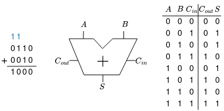
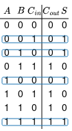
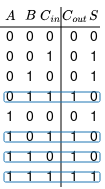
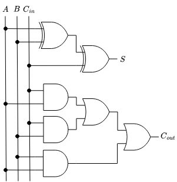
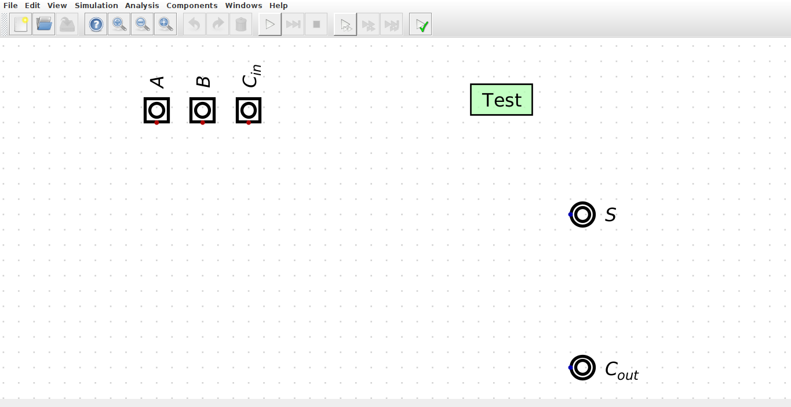
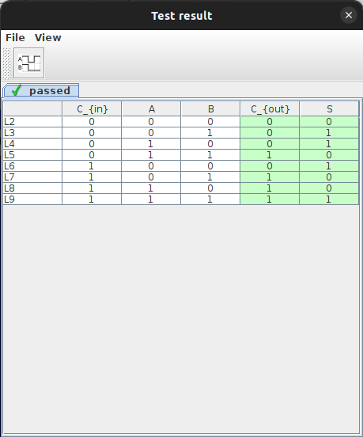

🌐 **English** | [Español](README.es.md)

# ex01

In this exercise, you will design and simulate a **Full Adder** to get familiar with the logic design and simulation software **Digital**. The tasks are:

- Derive the Boolean function from the truth table that describes how the circuit works
- From the Boolean function, build the logic gate schematic in the `fulladder.dig` file using **Digital**
- Verify the circuit's behavior with the **test** included in the file

## Full Adder

A **Full Adder** has 3 inputs, $A$, $B$ and $C_{in}$, and 2 outputs, $S$ and $C_{out}$.



To obtain the Boolean equations that let us implement the circuit, we use sum of products (SOP), that is, we add up the minterms for which the output is **TRUE**:

$S$:

|Truth Table|Boolean Equation|
|:---|:---|
||$S = \overline{A}\overline{B}C_{in} + \overline{A}B\overline{C_{in}} + A\overline{B}\overline{C_{in}} + ABC_{in}$ <br> $S = C_{in}(\overline{A}\overline{B} + AB) + \overline{C_{in}}(\overline{A}B +A\overline{B})$ <br> $S = C_{in}(\overline{A \oplus B}) + \overline{C_{in}}(A \oplus B)$ <br> $S = C_{in} \oplus A \oplus B$


$C_{out}$:

|Truth Table|Boolean Equation|
|:---|:---|
||$C_{out} = \overline{A}BC_{in} + A\overline{B}C_{in} + AB\overline{C_{in}} + ABC_{in}$ <br> Using Idempotency (T3): $B + B = B$, we get: <br> $C_{out} = \overline{A}BC_{in} + A\overline{B}C_{in} + AB\overline{C_{in}} + ABC_{in} + ABC_{in} + ABC_{in}$ <br> $C_{out} = BC_{in}(\overline{A} + A) + AC_{in}(\overline{B} + B) + AB(\overline{C_{in}} + C_{in})$ <br> $C_{out} = BC_{in} + AC_{in} + AB$

Logic gate circuit (schematic):



---
> ### Task 1
> 
> Build and simulate the circuit in **Digital**. From a terminal, make sure you are in the `workspace/digital-basic/ex01` path (you can check with `pwd`) and open the `fulladder.dig` file with **Digital**:
>
>  ```bash
>  $ Digital fulladder.dig
>  ```
>
> The file contains the inputs, the outputs, and a **test** to verify the circuit's behavior. Complete the schematic using logic gates, which you can find under `Components/logic` in **Digital**'s top menu.
>
> 
>
> Run the **test** to verify the circuit by clicking the **Run (play)** button with the green tick.
>
> If the circuit was implemented correctly, the pop-up window will show the output values in green. Otherwise, some values will be shown in red.
>
> 

>
> [!CAUTION] 
> The inputs and outputs in the schematic must have the same names as those defined in the **test**. It's best not to rename them, or else rename them in both places to avoid errors caused by mismatched names.

---

## Appendix (LLM generated): Boolean Algebra Axioms and Theorems

### Axioms of Boolean Algebra

| ID | Axiom | Dual | Name |
|----|-------|------|------|
| A1 | $B = 0$ if $B \neq 1$ | $B = 1$ if $B \neq 0$ | Binary field |
| A2 | $\overline{0} = 1$ | $\overline{1} = 0$ | NOT |
| A3 | $0 \cdot 0 = 0$ | $1 + 1 = 1$ | AND/OR |
| A4 | $1 \cdot 1 = 1$ | $0 + 0 = 0$ | AND/OR |
| A5 | $0 \cdot 1 = 1 \cdot 0 = 0$ | $1 + 0 = 0 + 1 = 1$ | AND/OR |

### Theorems of Boolean Algebra

| ID | Theorem | Dual | Name |
|----|---------|------|------|
| T1 | $B \cdot 1 = B$ | $B + 0 = B$ | Identity |
| T2 | $B \cdot 0 = 0$ | $B + 1 = 1$ | Null Element |
| T3 | $B \cdot B = B$ | $B + B = B$ | Idempotency |
| T4 | $\overline{\overline{B}} = B$ | $\overline{\overline{B}} = B$ | Involution |
| T5 | $B \cdot \overline{B} = 0$ | $B + \overline{B} = 1$ | Complements |
| T6 | $B \cdot C = C \cdot B$ | $B + C = C + B$ | Commutativity |
| T7 | $(B \cdot C) \cdot D = B \cdot (C \cdot D)$ | $(B + C) + D = B + (C + D)$ | Associativity |
| T8 | $(B \cdot C) + (B \cdot D) = B \cdot (C + D)$ | $(B + C) \cdot (B + D) = B + (C \cdot D)$ | Distributivity |
| T9 | $B \cdot (B + C) = B$ | $B + (B \cdot C) = B$ | Covering |
| T10 | $(B \cdot C) + (B \cdot \overline{C}) = B$ | $(B + C) \cdot (B + \overline{C}) = B$ | Combining |
| T11 | $(B \cdot C) + (B \cdot D) + (C \cdot D) = (B \cdot C) + (\overline{B} \cdot D)$ | $(B + C) \cdot (B + D) \cdot (C + D) = (B + C) \cdot (\overline{B} + D)$ | Consensus |
| T12 | $\overline{B_0 \cdot B_1 \cdot B_2 \cdots} = (\overline{B_0} + \overline{B_1} + \overline{B_2} \cdots)$ | $\overline{B_0 + B_1 + B_2 \cdots} = (\overline{B_0} \cdot \overline{B_1} \cdot \overline{B_2} \cdots)$ | De Morgan's Theorem |

### Notes

- In Boolean algebra, $+$ represents the OR operation
- $\cdot$ represents the AND operation
- $\overline{B}$ represents the NOT operation (complement of B)
- The **Principle of Duality** states that any theorem or axiom remains valid if we interchange:
  - OR ($+$) with AND ($\cdot$)
  - $0$ with $1$
  - The dual of each expression is obtained by applying these interchanges
