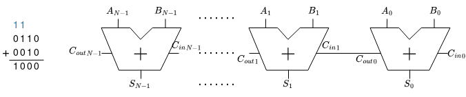
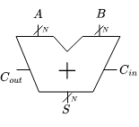
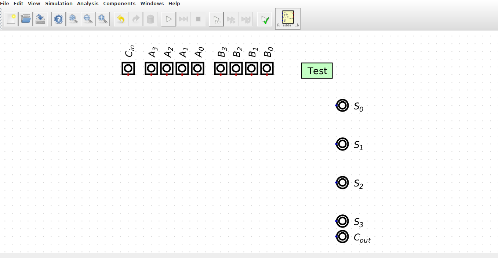
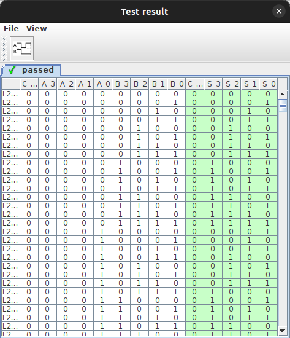

🌐 **English** | [Español](README.es.md)

# ex02

In this exercise, you will design and simulate a 4-bit **Adder**, taking advantage of **Digital**'s hierarchical design capabilities. The tasks are:

- Understand how to build a hierarchical design in **Digital**
- Use the **Full Adder** from `ex01` and instantiate it in `adder_4b.dig` to build a 4-bit **Adder**
- Verify the circuit's behavior with the **test** included in the file

## Ripple-Carry Adder

A simple way to build an $N$-bit **Adder** is to chain $N$ **Full Adders** together, where the $C_{out}$ output of one stage acts as the $C_{in}$ input of the next stage (also known as a **carry propagate adder (CPA)**, since $C_{out}$ propagates into the next $C_{in}$).



The symbol for a **CPA** is similar to that of a **Full Adder**, but it indicates that the inputs $A$, $B$, and the output $S$ are $N$-bit buses.



One drawback of this circuit is that it is slow when $N$ is large, since each stage must wait for the previous stage to finish computing $C_{out}$. Faster alternatives to the **Ripple-Carry Adder** include the **Carry-Lookahead Adder** and the **Prefix Adder**.

---
> ### Task 1
> 
> Build and simulate, in **Digital**, a 4-bit **Ripple-Carry Adder** using the **Full Adder** you created in `ex01`. From a terminal, make sure you are in the `workspace/digital-basic/ex02` path (you can check with `pwd`) and open the `adder_4b.dig` file with **Digital**:
>
>  ```bash
>  $ Digital adder_4b.dig
>  ```
>
> The file contains the inputs, the outputs, and a **test** to verify the circuit's behavior. Complete the schematic by instantiating the `fulladder` module from `Components/Custom`.
>
> 
>
> 

> [!IMPORTANT] 
> To instantiate a module from a `.dig` file, the file must be in the same working directory. We recommend making a copy using the `VSCode` file explorer, or from a terminal with the command:
>
> ```bash
> $ cp ../ex01/fulladder.dig ./
> ```
>

> Run the **test** to verify the circuit by clicking the **Run (play)** button with the green tick.
>
> If the circuit was implemented correctly, the pop-up window will show the output values in green. Otherwise, some values will be shown in red.
>
> 

>
> [!CAUTION] 
> The inputs and outputs in the schematic must have the same names as those defined in the **test**. It's best not to rename them, or else rename them in both places to avoid errors caused by mismatched names.

---
