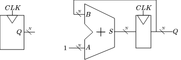
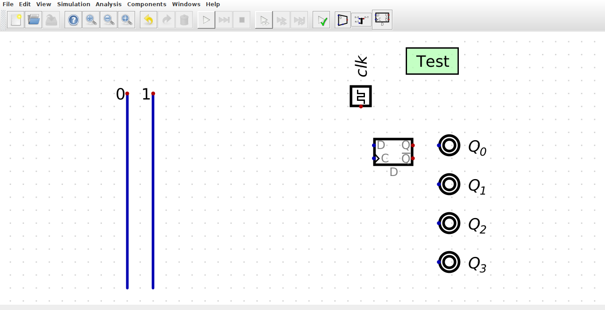
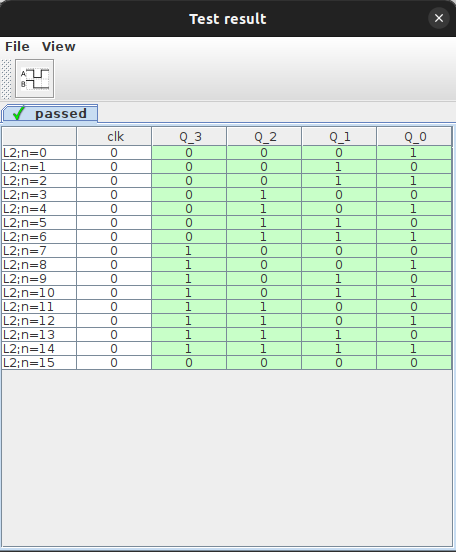

[](README.md) [](README.es.md)

# ex03

In this exercise, you will design and simulate a 4-bit **Counter**, taking advantage of **Digital**'s hierarchical design capabilities. The tasks are:

- Understand how to build a hierarchical design in **Digital** that includes sequential components (**flip-flops**)
- Use the **Adder** from `ex02` and instantiate it in `counter_4b.dig` to build a 4-bit **Counter**
- Verify the circuit's behavior with the **test** included in the file

## Counter

An $N$-bit binary **Counter** is a sequential circuit that receives a clock signal $CLK$ and has an $N$-bit output $Q$. Basically, on every clock cycle the output $Q$ increases by $1$. A **Counter** can therefore be built from an $N$-bit **Adder** and an $N$-bit **register** (or several **flip-flops**), where the **register** output is fed back into one of the **Adder** inputs while the other input receives a $1$.



---
> ### Task 1
> 
> Build and simulate, in **Digital**, a 4-bit **Counter** using the **Adder** you created in `ex02`. From a terminal, make sure you are in the `workspace/digital-basic/ex03` path (you can check with `pwd`) and open the `counter_4b.dig` file with **Digital**:
>
>  ```bash
>  $ Digital counter_4b.dig
>  ```
>
> The file contains the inputs, the outputs, and a **test** to verify the circuit's behavior. Complete the schematic by instantiating the `adder_4b` module from `Components/Custom`.
>
> 

> [!NOTE]
> To avoid clutter from too many wires (feedback), we recommend using a `Tunnel` (the triangle-shaped component) found under `Components/wires`. Tunnels let you make connections without drawing wires.

> Run the **test** to verify the circuit by clicking the **Run (play)** button with the green tick.
>
> If the circuit was implemented correctly, the pop-up window will show the output values in green. Otherwise, some values will be shown in red.
>
> 

>
> [!CAUTION] 
> The inputs and outputs in the schematic must have the same names as those defined in the **test**. It's best not to rename them, or else rename them in both places to avoid errors caused by mismatched names.

---

