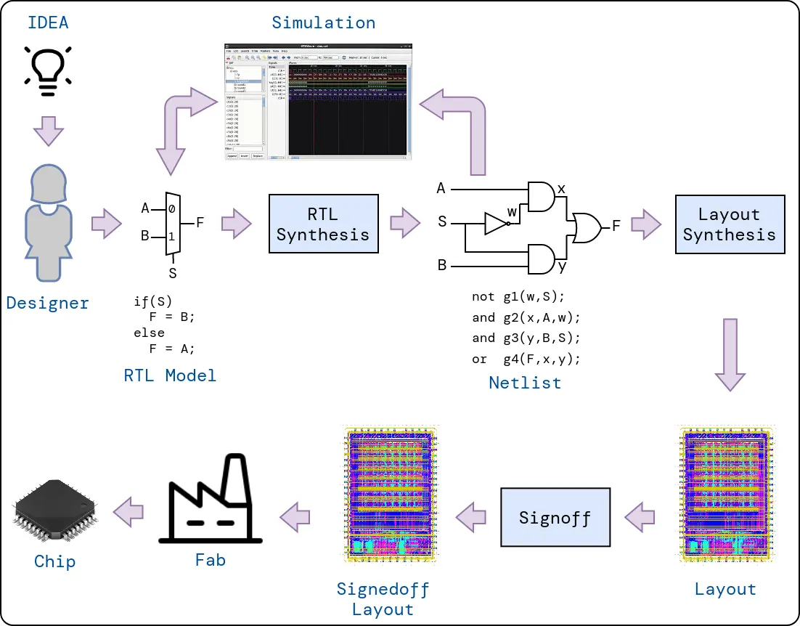
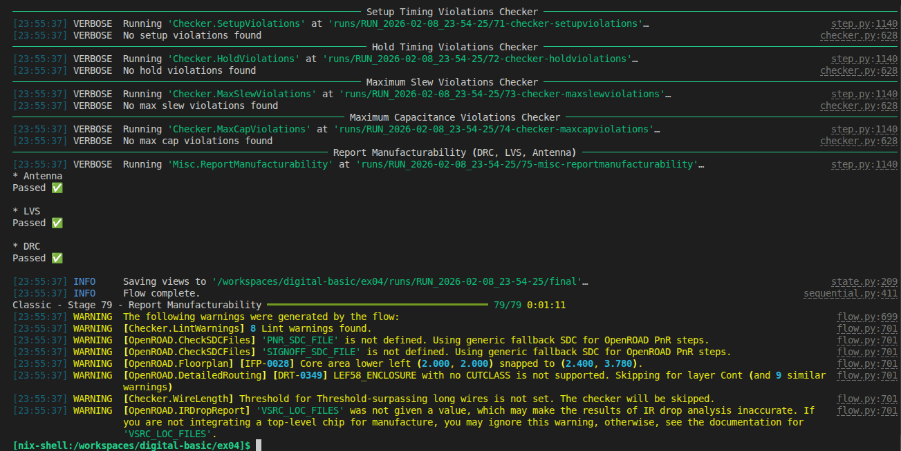

[](README.md) [](README.es.md)

# ex04

In this exercise, you will work through the digital integrated circuit (IC) design flow, using **Digital** to obtain a description of the schematic in a hardware description language (HDL), and **LibreLane** to obtain the GDS. The tasks are:

- Understand the concepts behind the digital IC design flow
- Export the **Counter** from `ex03` to **Verilog** using **Digital**
- Understand what **LibreLane** is and how to configure it, and run the **Counter** from `ex03` through the automated RTL-to-GDS flow

## IC Design Overview

Designing a chip is a complex task that involves several stages (which is why we talk about a *flow*), as well as expertise and attention to detail. The process starts with a design idea (a circuit that solves some problem) and ends with all the files needed for manufacturing, which are then sent to a fab (foundry) where the design is turned into silicon. Some stages of the design flow are:

- **Design Entry**: In this stage, we describe how our circuit will work using an HDL (Hardware Description Language), such as Verilog or VHDL. It's similar to writing a program, but instead of creating software, we are describing a physical circuit. Here we define what operations the chip will perform and how it will process information.
- **Verification**: Before moving on, we need to make sure our design works correctly. In this stage, we test the circuit through simulations to catch errors. It's like testing a video game before releasing it: we want to find and fix problems before manufacturing the real chip, because once it's made, it can't be changed!
- **Synthesis**: This is where the magic starts. The synthesis tool takes our HDL description and turns it into a real circuit made of logic gates (AND, OR, NOT, etc.). The result is called a **"Netlist"**, which is basically a list of all the gates we need and how they are connected to each other.
- **Layout/Physical Synthesis**: This is one of the most complex stages. We take the logic gate circuit and turn it into a physical plan that shows exactly where each component will go on the chip and how they will be connected. This stage includes several steps:

  - **Floorplanning**: Deciding where to place the different blocks of the circuit
  - **Placement**: Placing each gate in its specific position
  - **Routing**: Drawing all the connections between components (like laying out wires in a circuit)

- **Signoff**: This is the final stage, where we do a thorough review of everything. We check that the design works correctly, that it doesn't consume too much power, and that it meets all requirements. Only after this final approval is the design ready to be sent to the fab where the real chip will be produced.



### What is a **PDK**?

A **PDK** (Process Design Kit) is a set of files that describes the manufacturing capabilities of a semiconductor fab. Each **foundry** has specialized machinery that lets it manufacture chips with specific characteristics, such as the minimum size of components and their electrical properties. This set of capabilities and limitations is called a **technology process**.

To design a chip that can actually be manufactured, we need a **PDK** that gives us all the technical details and design rules of the specific technology process we are going to use. The **PDK** acts as a bridge between our design and what can really be manufactured.
In this exercise we will work with IHP's open-source **PDK**, which corresponds to a 130 nanometer (nm) technology process, `ihp-sg13g2`.

## LibreLane

LibreLane is an open-source tool that makes digital chip design easier. It works as an "automated assistant" that organizes and coordinates the different stages of the integrated circuit design process, letting designers create chips without having to configure each tool manually.
Main features:

  - **Easy to use**: LibreLane lets you configure the whole design flow through a single configuration file, instead of having to learn how to use multiple tools separately.
  - **Built on open-source tools**: It uses free and openly available tools, which makes it ideal for learning and experimenting without license costs.
  - **Flexible**: It can be customized to the specific needs of each project, either by editing the configuration file or by writing **Python** scripts.
  - **Active community**: As an open-source project, it has a community of users who share knowledge, resources, and solutions to common problems.

---
> ### Task 1
> 
> Export the HDL description of the 4-bit **Counter** you designed in `ex03` using **Digital**. From a terminal, make sure you are in the `workspace/digital-basic/ex03` path (you can check with `pwd`) and open the `counter_4b.dig` file with **Digital**:
>
>  ```bash
>  $ Digital counter_4b.dig
>  ```
>
> To export the circuit to Verilog, go to `File > Export > Export to Verilog` in **Digital**'s top menu and save the file as `counter_4b.v` in the same directory (`ex03`). Open the generated file in VS Code to inspect it.
>
> - What is the name of the top module? (You will need this name in the next task)
>
> Copy the generated Verilog file to the `src` directory of `ex04`:
>
>  ```bash
>  $ cp counter_4b.v ../ex04/src/
>  ```
> ### Task 2
> 
> Run the 4-bit **Counter** through the default **LibreLane** flow using the IHP **PDK**. From a terminal, make sure you are in the `workspace/digital-basic/ex04` path (you can check with `pwd`). This directory contains a `config.yaml` file, which is used to configure **LibreLane**, and a `src` directory (use `ls` to list the directory contents).
>
> First, check that the HDL description you exported earlier is in `ex04/src`:
>
>  ```bash
>  $ ls src/
>  ```
> 
> You should see the `counter_4b.v` file listed.
>
> The `config.yaml` file has the following content:
>
>  ```yaml
>  DESIGN_NAME: <top module name>
>  VERILOG_FILES: dir::<path to source>
>  CLOCK_PERIOD: 25
>  CLOCK_PORT: clk
>
>  FP_SIZING: absolute
>  DIE_AREA:  [0.00, 0.00, 50.00, 50.00]
>  CORE_AREA: [2, 2, 48, 48]
>  ```
>
> - **DESIGN_NAME**: Name of the main module of your Verilog design. It is the top-level module that contains the whole circuit.
> - **VERILOG_FILES**: Path or directory where the Verilog source files describing your circuit are located.
> - **CLOCK_PERIOD**: Clock period in nanoseconds (ns). In this case, 25 ns corresponds to a frequency of 40 MHz. This value determines how fast the chip will run.
> - **CLOCK_PORT**: Name of the clock signal in your Verilog design. It is usually called clk.
> - **FP_SIZING**: Chip sizing method. absolute means we will manually specify the exact chip size using coordinates.
> - **DIE_AREA**: Total chip area in micrometers (μm), defined by the coordinates [x_start, y_start, x_end, y_end]. In this case: a 50 μm × 50 μm square.
> - **CORE_AREA**: Usable area where the circuit components will be placed, also in micrometers. Here: a 46 μm × 46 μm area (leaving a 2 μm margin on each side for connections and power).
>
> To configure **LibreLane**, complete `config.yaml` with the missing information, in this case **DESIGN_NAME** and **VERILOG_FILES**.
>
>To use **LibreLane**, invoke `nix-shell`, which makes all the packages included with LibreLane available in your shell (this step may take a while, since some packages will be downloaded):
>
> ```
> $ nix-shell /opt/librelane/shell.nix
> ```
>
> By default, **LibreLane** uses the `sky130` **PDK**. However, the working environment has 2 environment variables that tell **LibreLane** to use IHP's open-source **PDK** `ihp-sg13g2`: `PDK` and `PDK_ROOT`. You can check their contents with:
>
> ```bash
> $ echo $PDK
> ```
> and
> ```bash
> $ echo $PDK_ROOT
> ```
>
>  To launch **LibreLane**, run the following command:
>
> ```bash
> $ librelane config.yaml
> ```
>
> If everything goes well, the end of your output should look like this:
>
> 
>
> Finally, use the following command to view the physical layout of your circuit:
>
> ```bash
> $ librelane --last-run --flow openinopenroad config.yaml
> ```
>
> This will open a graphical interface where you can explore how the components of your counter were laid out on the chip.
>
> ### Congratulations, you can now see your chip!
>
---
